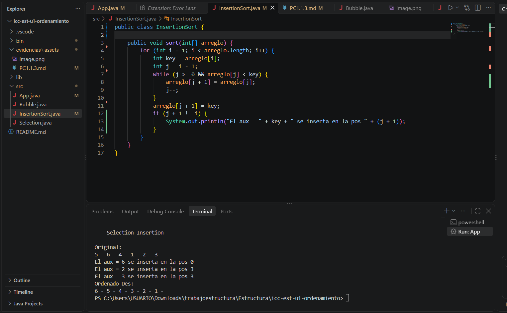

El código recorre el arreglo elemento por elemento. En cada paso, guarda el número actual en `key`, retrocede con `j` comparándolo con los anteriores, y los desplaza hacia la derecha mientras sean menores para finalmente insertar `key` en su hueco correspondiente.

......